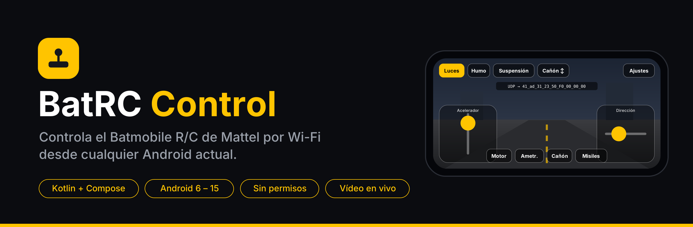
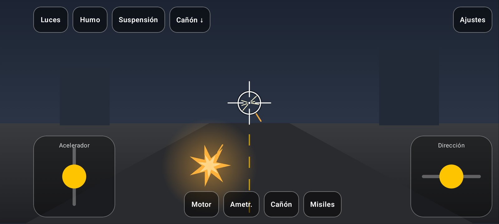
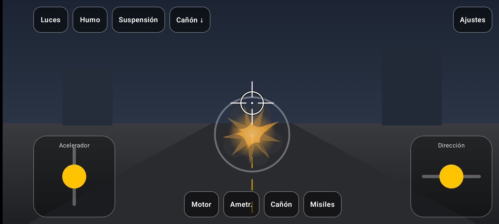
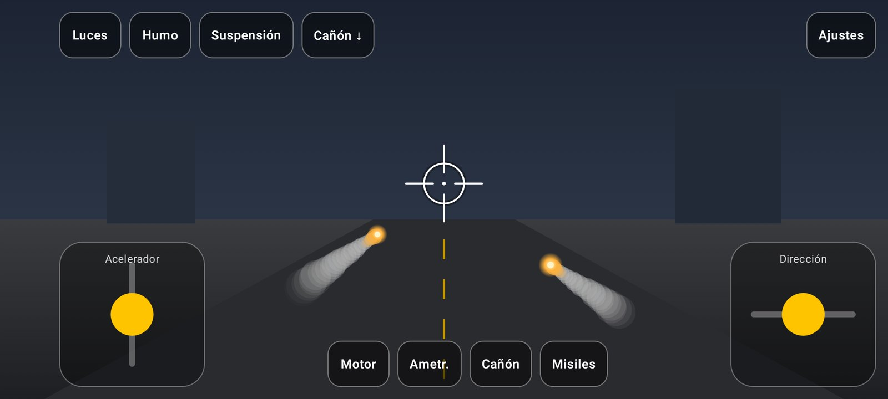
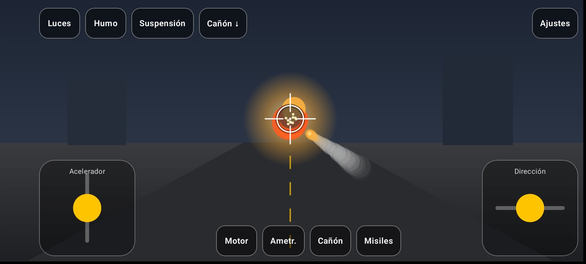
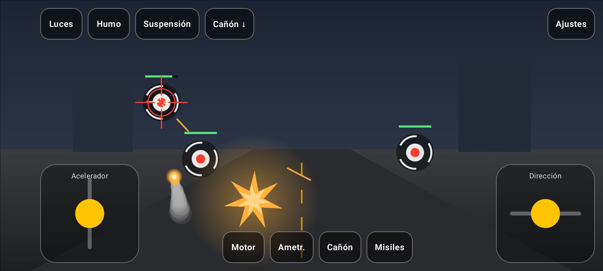
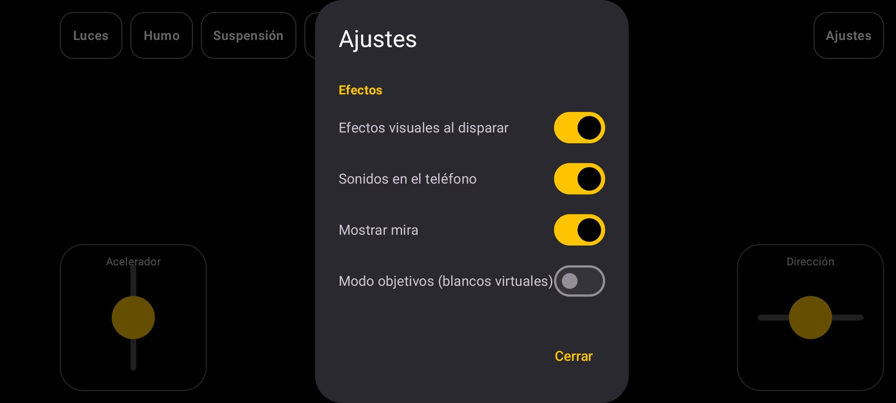
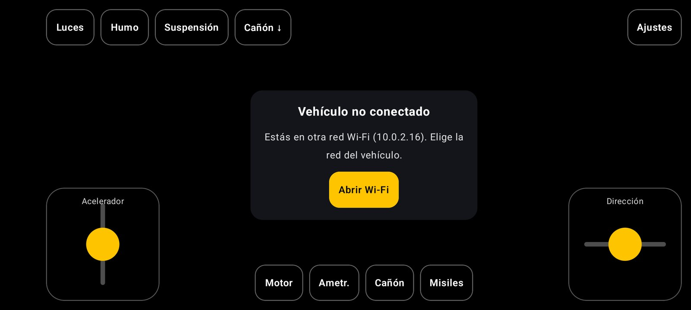
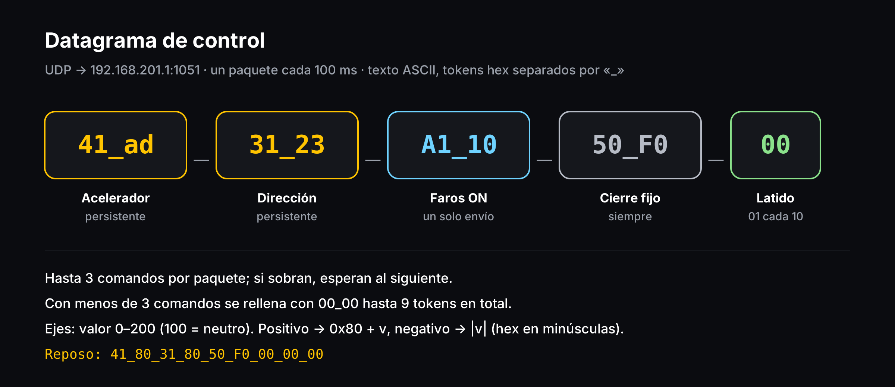
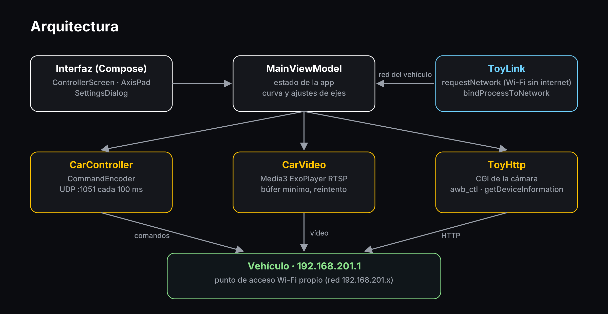

<p align="center">
  
</p>

<p align="center">
  <a href="https://github.com/web-gdl/bat-rc-android/releases/latest/download/BatRC-Control.apk"><b>⬇ Descargar APK</b></a>
  ·
  <a href="https://github.com/web-gdl/bat-rc-android/releases">Todas las versiones</a>
  ·
  <a href="https://github.com/web-gdl/bat-rc-android/actions/workflows/android.yml"></a>
</p>

# BatRC Control

App nativa para Android (Kotlin + Jetpack Compose) que controla por Wi-Fi el
**Batmobile R/C de Mattel** desde un teléfono actual.

La app oficial, *Batmobile R/C Controller v1.3.1*, ya no funciona en Android
moderno. Este proyecto reimplementa su protocolo, obtenido por ingeniería
inversa del APK original, en una app nueva y ligera.

> App no oficial, sin relación con Mattel, DC ni Warner Bros. No incluye
> gráficos, sonidos ni código de la app original.

## Características

- **Android 6.0 a 15** (API 23–35), en procesadores ARM y x86 de 32 y 64 bits
  y en dispositivos con páginas de memoria de 16 KB.
- **No pide permisos** al usuario: ni ubicación ni dispositivos cercanos.
- **Conexión automática** al Wi-Fi del vehículo aunque no tenga internet y los
  datos móviles sigan encendidos.
- **Vídeo en directo** de la cámara del vehículo (RTSP) con búfer mínimo y
  reconexión automática.
- **Todas las funciones:** acelerador, dirección, faros, humo, suspensión,
  cañón arriba/abajo, ametralladora, cañón, misiles y sonido de motor.
- **Ajustes:** invertir ejes, potencia máxima, ajuste fino de la dirección,
  mandos zurdos, vídeo por TCP y diagnóstico de los paquetes enviados.
- **Efectos al disparar** (nuevo en 1.1): fogonazos, cañonazo, misiles con
  estela, explosiones, sacudida de la imagen, vibración y sonidos en el
  teléfono, replicando el comportamiento de la app original.
- **Modo objetivos:** blancos virtuales sobre el vídeo para jugar a acertarles.
- **Parada de seguridad:** al salir de la app se para el motor y se apaga el humo.

## Capturas

Capturas reales de la app en un emulador de Android 14, generadas en cada
compilación. Sin vehículo no hay vídeo, así que las escenas de efectos usan un
fondo de demostración en lugar de la cámara.

| | |
|---|---|
|  |  |
| Ametralladora (mantener pulsado) | Cañonazo |
|  |  |
| Misiles en vuelo | Impacto |
|  |  |
| Modo objetivos: la mira se pone roja sobre un blanco | Ajustes de efectos |



## Efectos al disparar

Reproducen lo que hacía la app original, según su código (`FXController`,
`CannonFX`, `MachineGunFX`, `RocketFX`, `Crosshair` y el modo de juego). Los
gráficos y sonidos originales no estaban en el APK, así que los dibujos y
sonidos son propios.

| Arma | Comportamiento (como el original) |
|---|---|
| Ametralladora | Se mantiene pulsada; fogonazos en bucle, trazadoras y vibración cada 1 s |
| Cañón | Destello por fotogramas de 0,08 s; sale arriba o abajo según la posición del cañón |
| Misiles | Uno por pulsación, alternando lanzador; viaja 2,0 s hasta la mira y explota |
| Todas | Sacudida de la imagen y vibración al disparar |

En *Ajustes → Efectos* se pueden desactivar los efectos visuales, los sonidos
del teléfono o la mira, y activar el **modo objetivos**: aparecen blancos sobre
el vídeo, la mira se mueve con los mandos y se fija sola en un blanco cercano
(se pone roja), y cada arma les quita vida.

Los sonidos se generan con `tools/generar_sonidos.py`.

## Instalar

1. En el teléfono, abre
   **[BatRC-Control.apk](https://github.com/web-gdl/bat-rc-android/releases/latest/download/BatRC-Control.apk)**
   (siempre apunta a la última versión).
2. Abre el archivo descargado. Si Android lo pide, permite instalar apps desde
   el navegador.

## Usar

1. Enciende el vehículo y abre la app.
2. Pulsa **Abrir Wi-Fi** y conéctate a la red del vehículo. Si Android avisa de
   que la red no tiene internet, elige mantener la conexión.
3. La app detecta la red sola, arranca el vídeo y empieza a enviar el control.

Desliza arriba o abajo en **Acelerador** y a los lados en **Dirección**: el punto
donde apoyas el dedo es el neutro y al soltar vuelve al centro.

**Primera prueba, con las ruedas en el aire:**

- Si adelante y atrás salen cambiados: *Ajustes → Invertir adelante / atrás*
  (igual para la dirección).
- Si no hay imagen: *Ajustes → Forzar vídeo por TCP*.
- *Ajustes → Mostrar diagnóstico UDP* enseña cada paquete enviado.

## Estado

| Parte | Estado |
|---|---|
| Codificador de comandos | Probado: coincide con el código original en 20 000 pasos aleatorios |
| Compilación | Automática en GitHub Actions en cada cambio |
| Arranque e interfaz | Probados en un emulador de Android 14 en cada compilación (rama `capturas`) |
| Funcionamiento con el vehículo | **Sin probar todavía** con un vehículo real |

Pendiente de confirmar con el vehículo: que el rango `0x81`–`0xE4` sea
«adelante» (deducido del código original, no medido) y que la cámara emita
H.264. Si emitiera MJPEG, el vídeo no se vería; el control funcionaría igual.

¿Lo has probado? Abre un *issue* con tu teléfono, versión de Android y resultado.

## Protocolo



Datagramas UDP a `192.168.201.1:1051` cada 100 ms, en texto ASCII.

| Función | Comando |
|---|---|
| Acelerador | `41_xx` — adelante `0x81`–`0xE4`, atrás `0x01`–`0x64`, parada `41_80` |
| Dirección | `31_xx` — misma codificación, centro `31_80` |
| Faros | encender `A1_10`, apagar `A1_01` |
| Humo | encender `91_10`, apagar `91_01` |
| Suspensión (forma de carrocería) | `21_64` (conmuta) |
| Cañón arriba / abajo | `21_E4` (conmuta) |
| Ametralladora (rotación) | `11_E4` (un pulso) |
| Sonido n | `01_` + hex(n − 1): motor 1–3, misiles 101, cañón 102 |
| Ajuste de dirección | `B1_01` (−1), `B1_00` (restablecer), `B1_81` (+1) |

- Vídeo: `rtsp://192.168.201.1/live/ch00_0` (1280×720).
- HTTP: `/isp/awb_ctl.cgi?ENABLE=1` y `/custom/getDeviceInformation.cgi`.

Análisis completo:
[fase 1 — ingeniería inversa del APK](docs/fase1-analisis.md) ·
[fase 2 — diseño de la app](docs/fase2-app.md).

`tools/udp_test.py` enciende y apaga los faros desde un ordenador conectado al
Wi-Fi del vehículo, para comprobar el protocolo sin la app.

## Arquitectura



```
app/src/main/java/org/batrc/controller/
  protocol/   CommandEncoder (paquetes), Axis (curvas), Protocol (constantes)
  net/        ToyLink (enlace al Wi-Fi), CarController (bucle UDP), ToyHttp (CGI)
  video/      CarVideo (RTSP de baja latencia con Media3)
  fx/         Efectos: FxController (lógica), FxLayer (dibujo), FxSound, FxHaptics
  data/       SettingsStore (ajustes)
  ui/         Pantalla de control, mandos y ajustes (Compose)
```

## Compilar

**Android Studio** (Ladybug o posterior): *File → Open*, elige esta carpeta y
pulsa *Run*.

**Línea de comandos** (JDK 17 y SDK de Android):

    ./gradlew testDebugUnitTest assembleRelease

El APK queda en `app/build/outputs/apk/release/`.

**Publicar una versión:** cada cambio en `main` se compila, pasa los tests y
publica `BatRC-Control.apk` en la Release `v` + `versionName`
(`app/build.gradle.kts`). Para sacar una versión nueva, sube `versionName`
(por ejemplo a `1.0.1`); si no lo cambias, se actualiza el APK de la Release
actual.

### Firma

Sin configurar nada, el APK se firma con `keystore/debug.keystore`, una clave
de pruebas **pública** incluida en el repositorio. Así cada versión se instala
encima de la anterior, pero cualquiera podría firmar un APK con ella.

Para usar una clave privada, añade estos secretos en
*Settings → Secrets and variables → Actions*:

| Secreto | Valor |
|---|---|
| `BATRC_KEYSTORE_BASE64` | el keystore en base64 (`base64 -w0 mi.keystore`) |
| `BATRC_KEYSTORE_PASSWORD` | contraseña del keystore |
| `BATRC_KEY_ALIAS` | alias de la clave |
| `BATRC_KEY_PASSWORD` | contraseña de la clave |

Al cambiar de clave hay que desinstalar la versión anterior una vez.
